# WinIsland · Windows 灵动岛

一个用 Rust 编写的 Windows 桌面灵动岛插件。单一原生 exe，零运行时依赖，启动极快、占内存小。

> **零收集 · 零上传 · 零通讯** —— 所有数据只存在本机，源码开源可审计。

---

## 截图

以下截图均由本机运行的 **v0.16.7** 实体程序导出（用程序自带的 `--preview* / --demo` 离屏渲染参数，绘制路径与实机完全一致，非设计稿）。日程 / 待办 / 剪贴板为演示数据；薪资、作息、自选股均为泛化示例值，不含作者隐私。

### 胶囊：时间到秒 + 打工人情报轮播

| 今天已经赚了多少 | 今日工作进度条 | 已下班计时（动态切换倒计时） |
| --- | --- | --- |
| 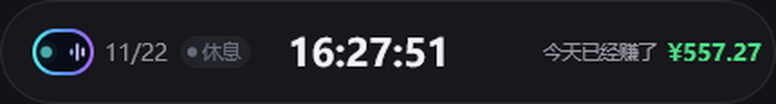 | 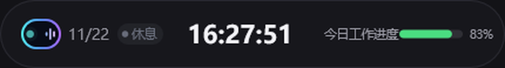 | 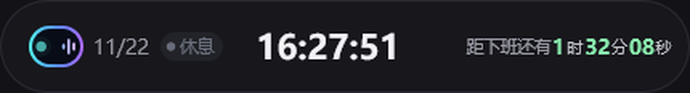 |

### 展开面板：8 页工具集

| 今日概览 | 日程安排 | 待办清单 | 文件中转站 |
| --- | --- | --- | --- |
| 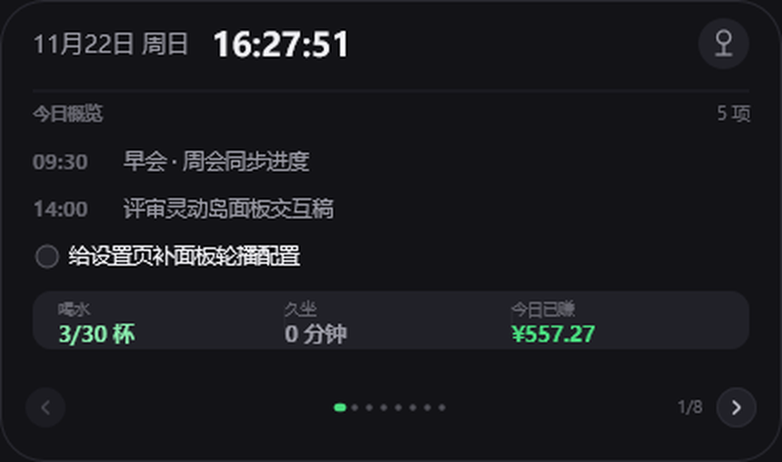 | 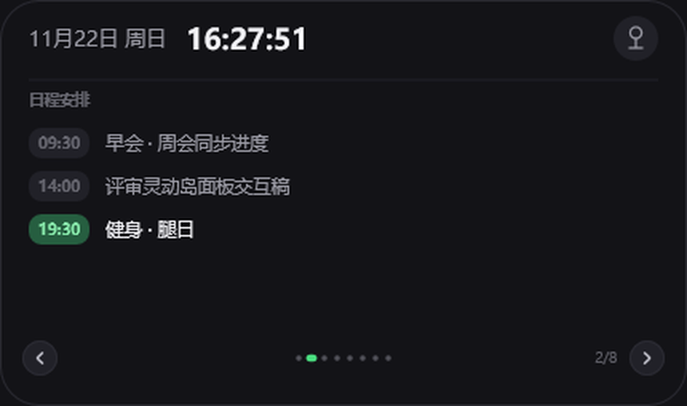 | 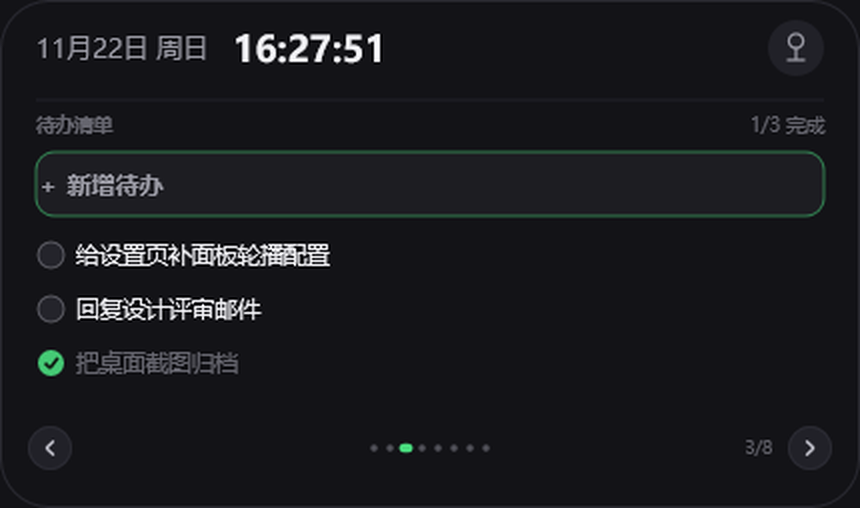 | 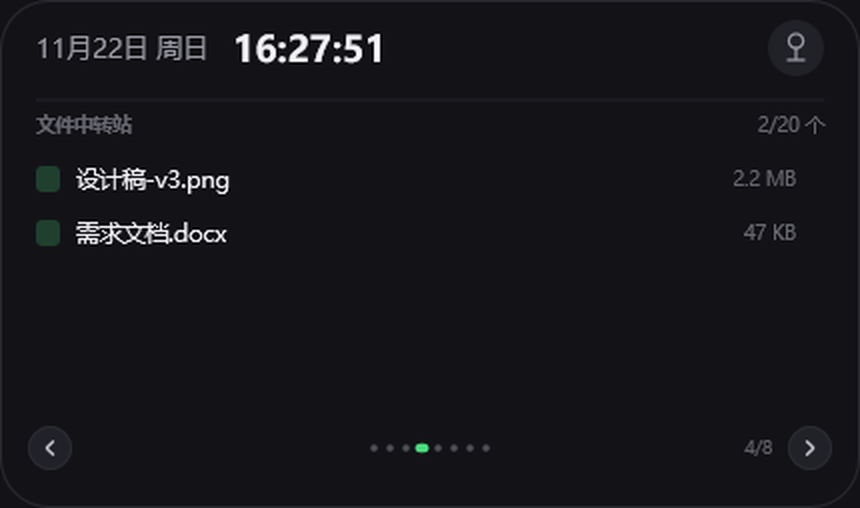 |

| 健康提醒 | 打工鼓励器 | 盯盘助手 |
| --- | --- | --- |
| 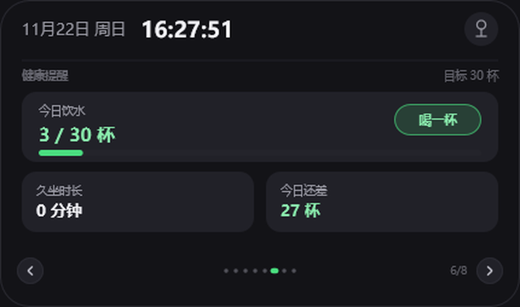 | 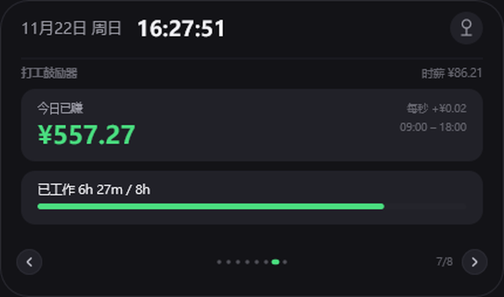 | 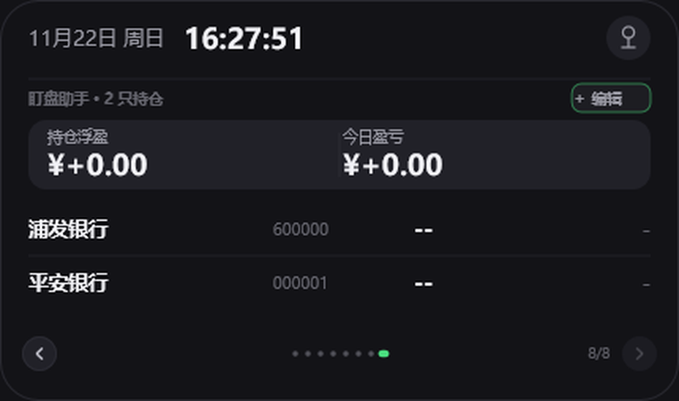 |

### 设置中心（13 页，节选）

| 打工鼓励器 | 日程安排 | 邮箱验证码 | 桌面分区 | 盯盘助手 |
| --- | --- | --- | --- | --- |
| 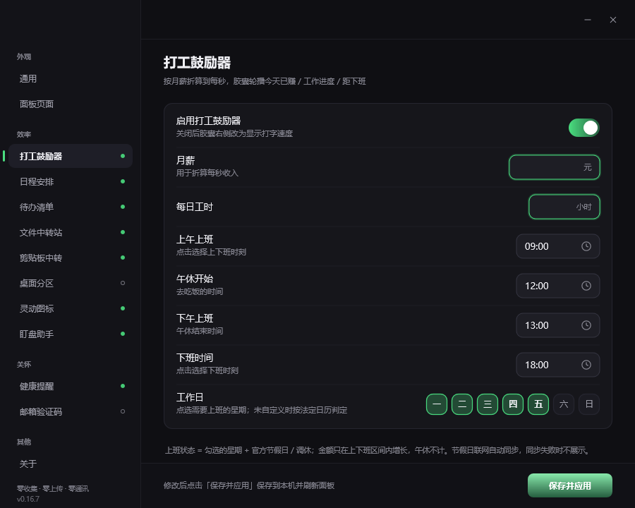 | 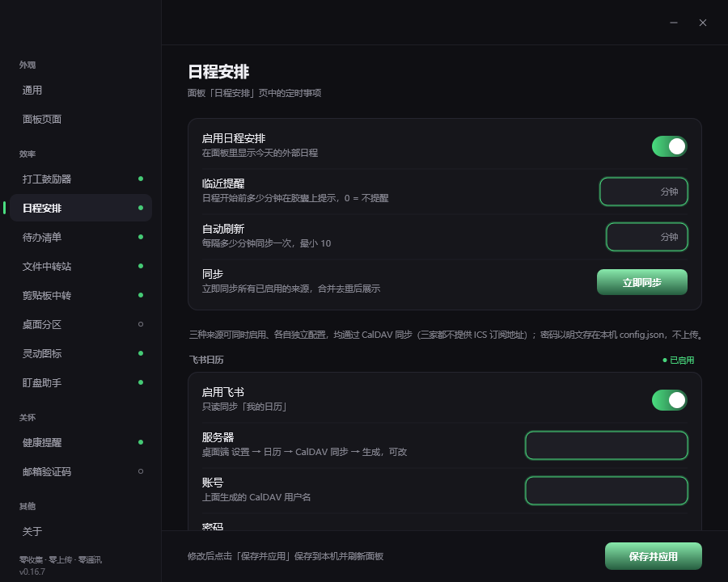 | 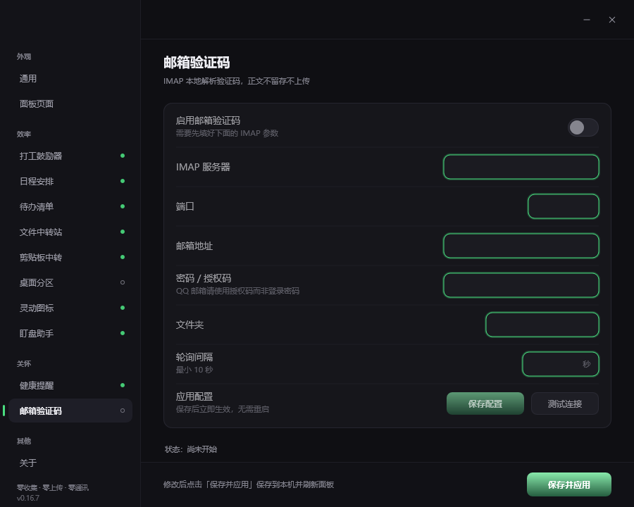 | 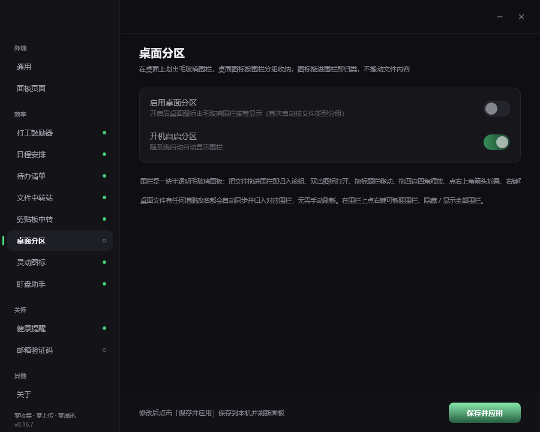 | 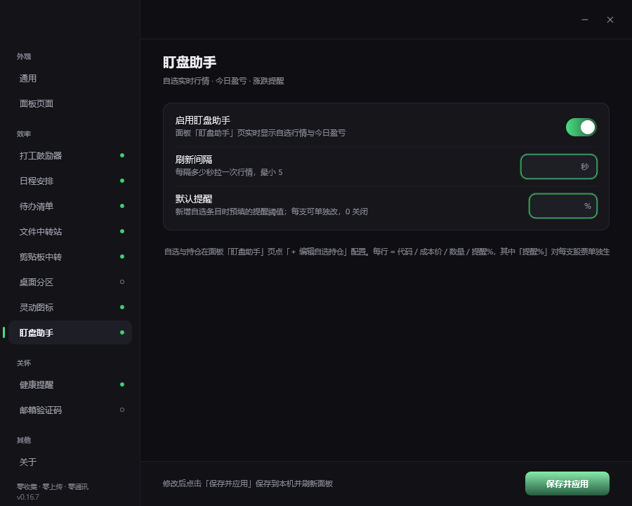 |

---

## 为什么选择 WinIsland

| 特性 | 说明 |
| --- | --- |
| 单一文件 | 编译产物就一个 `winisland.exe`（约 2.0 MB），无需安装 WebView / .NET / 运行库 |
| 原生性能 | Rust + Win32 + Direct2D/DirectWrite 自绘，vsync 出帧，空闲时零绘制零 CPU |
| 隐私优先 | 不截屏、不读窗口内容、不上传数据；打字只计数不记录键值 |
| 高度可定制 | 模块开关、面板顺序、主题色、图标、薪资作息等全部可配置 |
| 智能避让 | 被其它窗口压住时自动收起，不遮挡工作 |

---

## 功能一览

### 胶囊（常驻屏幕顶部）

屏幕顶部居中的 430×58 胶囊，时间**精确到秒**、时分秒同号大字并整体居中；日期在左侧，节日名（如「圣诞节」）以小字显示在日期下方：

- **两种模式**（托盘右键切换，当前模式带勾选）：
  - **工作模式**：左侧为上班状态徽标（上班 / 午休 / 下班 / 未上 / 休息，按法定工作日与作息判定）；右侧每 4.2 秒轮播 5 条：**今天已经赚了 ¥x.xx / 今天已经工作了 x时x分x秒 / 今天工作进度条 / 距午休·下班倒计时（动态切换「距午休还有 / 午休剩余 / 距下班还有 / 已下班」并实时走秒）/ 今天已经输入了 xx 字**。数值大字彩色、单位小字，一眼分清。
  - **盯盘模式**：左侧固定显示「盯盘中」；右侧轮播每只自选一条「名称 现价 涨跌幅」（A 股红涨绿跌），有持仓时追加「今日盈亏 ¥±x.xx」（较昨收）。
- **声浪图标**：打字或播放声音时辉光频谱随风律动，只取音量峰值、不录音
- **提醒态**：久坐 / 喝水 / 日程临近 / 邮箱验证码时，提醒内容在胶囊上常亮，点击确认后恢复；验证码点「复制」后显示「已复制」反馈并于 5 秒后消失
- **智能避让**：被其它窗口压住时收成 132×10 小黑条，悬停显示胶囊、移开收回；判定区域随当前形态（胶囊 430×58 / 面板 430×254）自动切换

### 展开面板（单击胶囊展开）

8 个页面可自由开关、调整顺序，底部箭头翻页（滚轮滚动当前页长内容）：

| 页面 | 能力 |
| --- | --- |
| 今日概览 | 今日日程 + 待办项数摘要，底部「喝水 / 久坐 / 今日已赚」状态条 |
| 日程安排 | 对接外部日历（飞书 / 钉钉 / 企业微信 CalDAV），自动合并去重；已过条目变灰、下一条高亮 |
| 待办清单 | 面板内直接新增 / 勾选完成 / 悬停删除，未完成优先排序，仅存本机 |
| 文件中转站 | 文件拖进岛上自动展开面板暂存（数量上限可在设置里调整，默认 20，满额拒绝），单击直接打开文件 / 悬停二次确认删除 |
| 剪贴板中转 | 自动记录本机剪贴板历史，点击复制回剪贴板 |
| 健康提醒 | 久坐与喝水提醒，均按真实时间流逝计时（打字或不操作都照常累计），阈值可自定义 |
| 打工鼓励器 | 按月薪 / 作息实时折算，扣除午休；可自定义每周上班日与上下班时间，节假日联网自动同步（失败静默不展示），节日名显示在日期下方 |
| 盯盘助手 | A 股实时行情 · 今日盈亏 · 涨跌提醒（**红涨绿跌**）；自选 + 持仓配置，启动 / 打开面板即自动补拉行情、交易时段定时刷新（腾讯公开行情），不做任何交易 |

> 持仓（成本价 + 数量）自动计入「今日盈亏」（相对昨收）与「持仓浮盈」（相对成本价）。

### 图钉锁定

展开面板右上角的**图钉按钮**（未锁定为灰色描边、锁定后为主题色实心）：

- 点击后当前面板**固定展开**，即使被其它窗口遮挡也不会自动收成小黑条；再点一次解除
- 锁定瞬间面板自动展开；点头部日期时间 / 点胶囊 / 托盘左键收起时会一并解除锁定
- 操作有短提示反馈

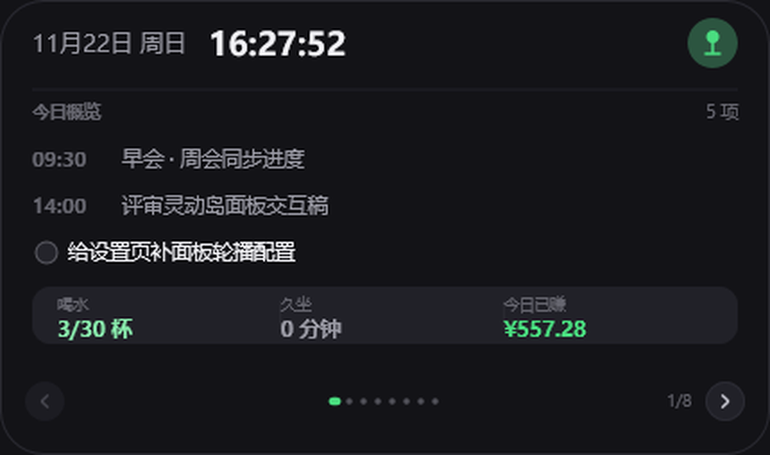

### 桌面分区（像 Fences 一样收纳桌面图标）

- **毛玻璃围栏**：桌面图标真正排进几块半透明围栏（图片 / 应用 / 其他等），按扩展名自动分类；没有同名围栏的统一进「其他」，任何图标都不会因为没归属而消失
- **壁纸保留**：只隐藏 Explorer 的图标列表窗口（`SysListView32`），不隐藏壁纸绘制层；图标层被手动恢复或 Explorer 重启后 3 秒兜底轮询自动重新接管；全部分区隐藏 / 为空时把图标还给桌面
- **实时同步**：接入 Shell 变更通知（`SHChangeNotifyRegister`），桌面新建 / 复制 / 改名 / 删除后 **240ms 去抖**自动归档，3 秒兜底轮询防止通知漏投
- **文件级右键菜单**：右键围栏里单个图标弹出 **Explorer 同款系统菜单**（打开方式、压缩、属性、重命名、删除……），7-Zip / Git / 云盘同步等第三方外壳扩展也原样出现；右键空白处是围栏菜单（改名 / 换色 / 透明度 / 折叠 / 新建 / 删除）
- **围栏管理**：拖动 / 缩放 / 折叠 / 换色 / 改名 / 一键隐藏全部；滚轮翻页查看密集图标；支持开机自启

### 邮箱验证码

- IMAPS 本地拉取，只在你自己配置的邮箱上读信；**正文不上传**，仅本地解析验证码数字
- **解析**：候选评分制提取验证码，兼容中文邮件主题与正文（RFC 2047 多段编码、base64 / quoted-printable 解码），关键词涵盖验证码 / 校验码 / 动态码 / 确认码 / code is / your code 等；能处理被 HTML 标签拆开、QP 编码吞首位等真实邮件脏数据
- **只弹新邮件**：按序号拉最近 30 封，以 UID 水位 + 邮件线程序号判定新旧，跨重启记住已处理邮件；启动前积压的旧验证码不弹，启动后新到的一定弹
- **可观测**：设置页底部实时状态行显示「监听中 · 每 N 秒检查一次 / 拉到 N 封 · 旧 M · 最大UID · seq N/M · 最近主题」或红色连接失败原因；「测试连接」按钮只握手登录 + 打开收件箱，不消费验证码
- **轮询间隔**默认 20 秒，可调 10–600 秒，改参数即时生效；点击胶囊上的「复制」后显示「已复制」并在 5 秒后消失

### 盯盘助手（A 股）

- **面板页**：左右双栏盈亏卡（左「持仓浮盈」相对成本价 / 右「今日盈亏」相对昨收，两个口径并排对照，红涨绿跌），下方是放大的自选列表（名称 / 代码 / 现价 / 涨跌幅），滚轮滚动
- **编辑窗口**：面板标题右侧「＋ 编辑」弹出程序内窗口，每行 = 代码 / **现价（只读，来自内存快照）** / 成本价 / 数量 / **提醒%**；代码 / 数字列限制字符输入、禁用中文输入法残留并自动归尾；输入 6 位代码后自动异步拉取行情补全名称与现价（**暂不支持拼音 / 名称搜索**）
- **提醒**：每支股票独立设置提醒% —— 该股涨跌幅绝对值超过阈值当天弹一次，0 表示这支不提醒
- **行情**：腾讯公开接口（免登录、无需 key），GBK 自动转 UTF-8；启动应用与打开盯盘页都会自动补拉一次（收盘后同样有效），交易时段按设定间隔刷新；只请求自选代码，不下单、零上传

### 其它能力

- **主题色**：海蓝 / 青碧 / 青草 / 罗兰 / 樱粉 / 落橙 / 绯红 7 种，点击即时生效
- **时间选择器**：打工鼓励器的上下班时间等字段改为自绘时间选择器，支持 ▲▼ 步进，也可直接键盘输入数字（时列输满两位自动跳到分列，Tab / Enter / Esc / 退格可用）
- **手动同步**：设置里改完文本参数后点底部「保存并应用」，再按需点「同步」刷新面板内容；失焦 / 切页不会误触发同步
- **开机自启**：HKCU Run 注册表键，静默启动不弹窗
- **系统托盘**：左键显示 / 隐藏 + 展开切换；右键菜单「工作 / 盯盘模式、显示 / 隐藏、设置…、退出」。托盘图标、程序窗口与 exe 内嵌图标统一为灵动岛 logo（资源管理器 / 任务栏 / ALT-TAB / 任务管理器一致）

---

## 快速开始

1. 从 [Releases](../../releases) 下载 `winisland.exe`，或自行构建
2. 双击运行，灵动岛出现在屏幕顶部居中
3. **单击胶囊**展开面板，点面板头部日期时间收回；右上角图钉可锁定面板不被遮挡收起
4. 右键托盘图标 → **设置**，打开设置中心配置模块与参数

> 首次运行会在 `%APPDATA%\WinIsland\` 生成默认配置，所有修改即时生效并写入本机。

---

## 使用指南

### 交互

| 操作 | 效果 |
| --- | --- |
| 单击胶囊 | 向下展开下拉面板 |
| 点面板右上角图钉 | 锁定 / 解除锁定面板（锁定后遮挡也不收起） |
| 点面板头部日期时间 | 收起为胶囊（同时解除图钉锁定） |
| 点面板底部 ◀ ▶ | 翻页（滚轮滚动当前页长内容，列表页带细滚动条） |
| 鼠标悬停小黑条 | 临时显示胶囊，移开自动收回 |
| 托盘左键 | 展开 / 收起 |
| 托盘右键 | 工作模式 / 盯盘模式切换、显示 / 隐藏、设置、退出 |

### 设置中心

自绘界面（Direct2D + DirectWrite），左侧分组导航、右侧卡片式配置。共 13 页：

- **外观**：通用、面板页面（开关 + ↑↓ 调顺序）
- **效率**：打工鼓励器、日程安排、待办清单、文件中转站、剪贴板中转、桌面分区、灵动图标、盯盘助手
- **关怀**：健康提醒、邮箱验证码
- **其他**：关于

开关 / 按钮点击即生效；文本 / 时间字段修改后点窗口底部「保存并应用」，再按需点面板上的「同步」刷新显示（失焦 / 切页不自动同步）。

### 外部日历

设置 → 日程安排里按来源（飞书 / 钉钉 / 企业微信）分别配置 CalDAV 三件套：**服务器 / 账号 / 密码**。三家都不提供 ICS 订阅接口，因此统一走 CalDAV：

| 来源 | 默认服务器 |
| --- | --- |
| 飞书 | `caldav.feishu.cn` |
| 钉钉 | `calendar.dingtalk.com`（支持带路径，如 `/dav`） |
| 企业微信 | `wecom.work`（自动走 `caldav.wecom.work`） |

三种来源可同时启用、各自独立配置。点「立即同步」合并所有已启用来源，按时间排序去重；单个来源失败只影响自己。只请求你填的那一个地址，不带 cookie、不上传任何东西。

### 命令行参数

| 参数 | 说明 |
| --- | --- |
| `--settings` | 启动后直接打开设置窗口 |
| `--sync-holidays` | 只跑一次节假日同步，打印结果后退出 |
| `--occ [x y w h]` | 打印一次遮挡判定结果，排查收起问题 |
| `--probe` | 自动展开一次面板并采样真实帧间隔 |
| `--preview [目录] [--demo]` | 离屏渲染各面板页为 BMP（`--demo` 注入示例数据，README 截图即由此导出） |
| `--preview-panel` / `--preview-anim` / `--preview-wave` / `--preview-icons` / `--preview-pill` / `--preview-reminder` / `--preview-settings` | 各类离屏导图，用于 UI 验证 |

---

## 数据与配置

| 文件 | 内容 |
| --- | --- |
| `%APPDATA%\WinIsland\config.json` | 模块开关、面板页面、模式（工作 / 盯盘）、主题色、图标、声音联动、遮挡收起、薪资作息、健康阈值、外部日历 / IMAP 凭据、盯盘参数、自启 |
| `%APPDATA%\WinIsland\watchlist.txt` | 盯盘自选 / 持仓（每行 `代码 成本价 数量 提醒% 名称`，名称可含空格；兼容旧格式 `代码 名称 成本价 数量`） |
| `%APPDATA%\WinIsland\data.json` | 待办、剪贴板历史、打字 / 喝水统计、提醒与验证码去重状态 |
| `%APPDATA%\WinIsland\schedule_ics.json` | 外部日历当天同步结果缓存 |
| `%APPDATA%\WinIsland\holidays.json` | 官方节假日 / 调休缓存，可离线复用 |

---

## 隐私承诺

- 打字统计只做**按键计数**，不记录键值、窗口标题或任何内容
- 声音联动只读取输出设备响度峰值（0~1 数值），不录制、不存储音频
- 遮挡避让只枚举窗口矩形，不截屏、不读窗口内容
- 剪贴板 / 待办 / 文件仅存本机数据文件夹
- 邮箱验证码走用户自己配置的 IMAP，仅本地解析验证码数字；正文不上传
- 盯盘助手只请求用户配置的自选行情（腾讯公开接口），不上传自选 / 持仓 / 盈亏，不进行任何交易
- 外部日历只请求用户配置的日历服务器地址，不带 cookie
- 唯一的对外请求是可选的公开节假日数据下载，**零上传**

---

## 构建

项目为 **Windows-only**（依赖 Win32 Direct2D/DirectWrite/DWM）。

**Windows 本机（msvc）**：直接构建，`build.rs` 会自动调用 Windows SDK 的 `rc.exe` + MSVC 的 `cvtres.exe` 把 `assets/icon.ico` 嵌进 exe：

```bash
cargo build --release
# 产物：target/release/winisland.exe（约 2.0 MB）
```

**macOS / Linux 交叉编译**：需 `cargo-zigbuild` + zig，`build.rs` 自动改用 zig 的资源编译器；仓库自带 `build.sh` 统一构建流程，产物固定复制到 `target/release/winisland.exe`，交叉编译缓存放在系统缓存目录（`~/.cache/winisland-cross-build`，可用 `WINISLAND_BUILD_DIR` 覆盖）：

```bash
rustup target add x86_64-pc-windows-gnu
./build.sh
```

等效的手动命令（产物落在 `target/x86_64-pc-windows-gnu/release/`，需自行复制）：

```bash
cargo zigbuild --release --target x86_64-pc-windows-gnu
```

依赖仅 `windows`（系统 API）、`serde` / `serde_json`（本地配置）、`rustls`（IMAPS / HTTPS）、`encoding_rs`（A 股行情 GBK 解码），全部静态编译进单一 exe。

CI 在 `windows-latest` 上执行 `cargo check / clippy / build --release`，并把 exe 作为 artifact 上传。

---

## 已知限制

- 高 DPI 按系统缩放渲染，多屏混合 DPI 场景待完善
- 邮箱验证码需在设置里填入 IMAP 账号（默认关闭）
- 盯盘助手目前仅支持 A 股公开行情（沪 / 深 / 北），新增自选暂不支持拼音 / 名称搜索
- 日历解析暂不支持：全天事件、`MONTHLY` / `YEARLY` 重复事件

已记录的待办问题见 [BUGS.md](docs/BUGS.md)。

---

## Roadmap

- [ ] 文件中转站跨设备传输（局域网配对）
- [ ] 验证码自动填充（模拟粘贴）
- [ ] 更多胶囊形态：番茄钟 / 音乐联动
- [ ] 毛玻璃（Mica / Acrylic）背景

---

## License

[MIT](LICENSE)
